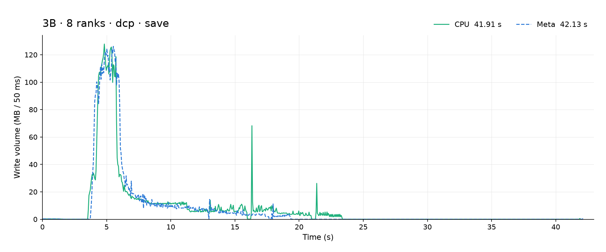
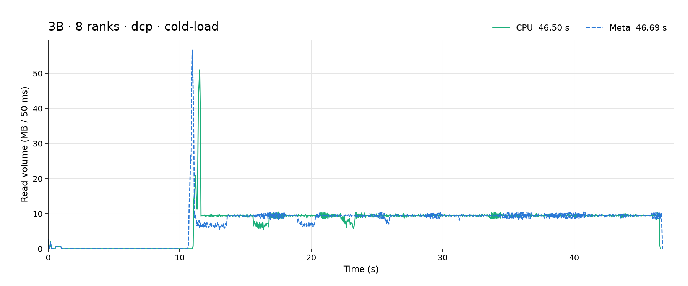
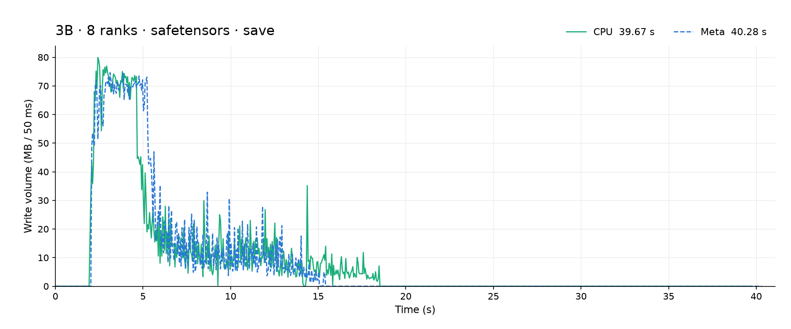
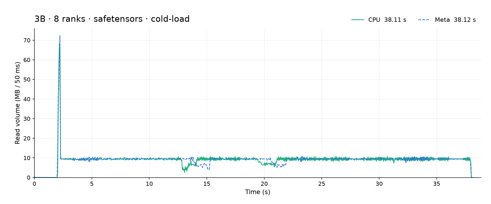
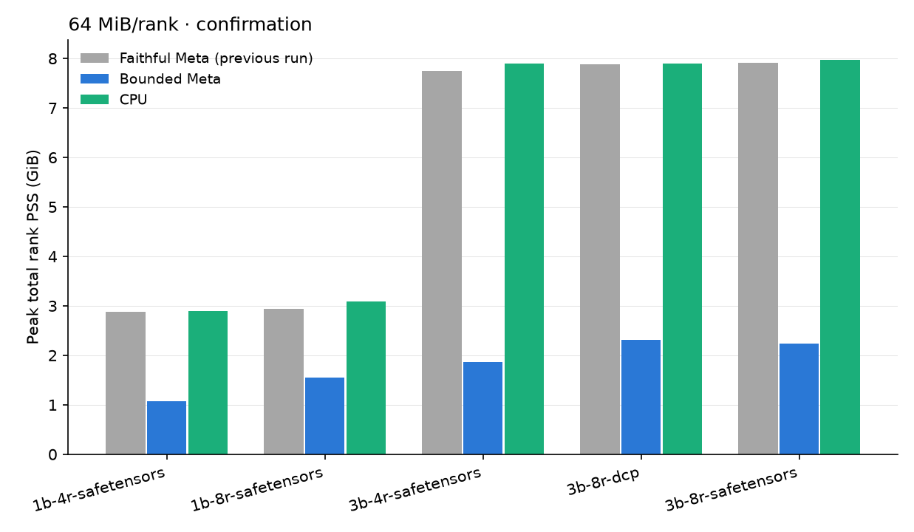

# Bounded Meta host memory

Chosen buffer: 64 MiB per rank, capped at the local shard size. It is the smallest swept size passing all four shared-safetensors cells.

Smaller reused mappings can reduce cache and TLB pressure compared with CPU's distinct shard pages. The 64 MiB ring also splits the largest 3B compute ranges into multiple callbacks, while 256 MiB holds those ranges without splitting. Extra callbacks and chunk assembly may offset the reuse benefit, so timing need not vary monotonically with capacity. This is a hypothesis based on the implementation and timings, not hardware-counter proof. The request signatures verify unchanged file offsets, sizes and order; the owner's symmetric timing gate decides acceptance. Some bounded phases remain faster than the allowed tolerance and fail.

## Design and files

`MetaLoadSink` and `MetaSaveSource` reuse one writable, pre-faulted ring per rank for zero-pattern save/load. Preparation occurs before the checkpoint timer; callback pieces reuse the mapping without changing file requests. Faithful mode retains the full-shard reference; position data does not use the zero-pattern ring.

Changed files: `metasl/gdt_storage.py`, `scripts/run_gdt_safetensors.py`, `scripts/run_meta_bounded_mem.py`, `scripts/analyze_meta_bounded_mem.py`, `README.md`, `tests/test_meta_cpu_target_sink.py`, `tests/test_shared_hf_storage.py`, `tests/test_gdt_measurement_runner.py`, `tests/test_meta_bounded_analysis.py`, and `tests/test_meta_bounded_runner.py`.

The runner's automatic zero-pattern CPU-target Meta path selects ring mode at 64 MiB. Automatic Meta-sim and position-pattern paths select fresh mode. The low-level fresh default and explicit ring capacity default of 256 MiB stay unchanged. Historical matrices explicitly selecting faithful remain references.

## Method

Paired/interleaved Meta versus CPU. The sweep uses three repetitions; confirmation uses five shared-safetensors repetitions and three DCP repetitions. Save includes fsync. For each repetition, phase time is the maximum rank's `dcp_wall_seconds`; the median paired Meta-minus-CPU difference must fall within max(3% of median CPU, 0.1 s). Every rank/phase/repetition must have identical full request signatures. Warm loads require >=99% residency after buffer preparation and before timing, with <=64 KiB timed block reads per rank and one retry permitted.

Validation: 96 focused tests passed: 42 core, 41 runner-default, nine analysis, and four orchestration checks. Logs and JUnit records are retained in this output.

## Sweep

| MiB/rank | Cell | Phase | Meta s | CPU s | Paired Δ s | Paired Δ % | Time | Requests | Warm |
| --- | --- | --- | --- | --- | --- | --- | --- | --- | --- |
| 64 | 1b-4r-safetensors | save | 12.835 | 13.006 | -0.078 | -0.60 | pass | identical | valid |
| 64 | 1b-4r-safetensors | cold-load | 11.453 | 11.168 | 0.277 | 2.48 | pass | identical | valid |
| 64 | 1b-4r-safetensors | warm-load | 1.130 | 1.155 | -0.008 | -0.66 | pass | identical | valid |
| 64 | 1b-8r-safetensors | save | 13.146 | 13.180 | -0.034 | -0.26 | pass | identical | valid |
| 64 | 1b-8r-safetensors | cold-load | 11.393 | 11.417 | -0.032 | -0.28 | pass | identical | valid |
| 64 | 1b-8r-safetensors | warm-load | 1.326 | 1.347 | -0.003 | -0.24 | pass | identical | valid |
| 64 | 3b-4r-safetensors | save | 39.707 | 38.985 | 0.789 | 2.02 | pass | identical | valid |
| 64 | 3b-4r-safetensors | cold-load | 37.402 | 37.475 | -0.073 | -0.20 | pass | identical | valid |
| 64 | 3b-4r-safetensors | warm-load | 3.868 | 3.924 | -0.051 | -1.30 | pass | identical | valid |
| 64 | 3b-8r-safetensors | save | 40.169 | 39.967 | 0.158 | 0.40 | pass | identical | valid |
| 64 | 3b-8r-safetensors | cold-load | 38.154 | 38.165 | -0.010 | -0.03 | pass | identical | valid |
| 64 | 3b-8r-safetensors | warm-load | 4.317 | 4.227 | 0.041 | 0.97 | pass | identical | valid |
| 256 | 1b-4r-safetensors | save | 12.964 | 13.004 | -0.041 | -0.31 | pass | identical | valid |
| 256 | 1b-4r-safetensors | cold-load | 11.187 | 11.162 | 0.029 | 0.26 | pass | identical | valid |
| 256 | 1b-4r-safetensors | warm-load | 1.309 | 1.225 | 0.074 | 6.02 | pass | identical | valid |
| 256 | 1b-8r-safetensors | save | 13.252 | 13.336 | -0.034 | -0.26 | pass | identical | valid |
| 256 | 1b-8r-safetensors | cold-load | 11.422 | 11.426 | -0.000 | -0.00 | pass | identical | valid |
| 256 | 1b-8r-safetensors | warm-load | 1.408 | 1.418 | 0.010 | 0.71 | pass | identical | valid |
| 256 | 3b-4r-safetensors | save | 39.193 | 38.856 | 0.304 | 0.78 | pass | identical | valid |
| 256 | 3b-4r-safetensors | cold-load | 37.344 | 37.447 | -0.116 | -0.31 | pass | identical | valid |
| 256 | 3b-4r-safetensors | warm-load | 3.626 | 3.928 | -0.388 | -9.88 | fail | identical | valid |
| 256 | 3b-8r-safetensors | save | 40.120 | 39.965 | -0.072 | -0.18 | pass | identical | invalid |
| 256 | 3b-8r-safetensors | cold-load | 38.129 | 38.175 | -0.099 | -0.26 | pass | identical | invalid |
| 256 | 3b-8r-safetensors | warm-load | 4.158 | 4.258 | -0.100 | -2.34 | invalid/incomplete | identical | invalid |
| 1024 | 1b-4r-safetensors | save | 12.867 | 12.735 | 0.143 | 1.12 | pass | identical | valid |
| 1024 | 1b-4r-safetensors | cold-load | 11.176 | 11.341 | -0.165 | -1.45 | pass | identical | valid |
| 1024 | 1b-4r-safetensors | warm-load | 1.260 | 1.288 | -0.063 | -4.86 | pass | identical | valid |
| 1024 | 1b-8r-safetensors | save | 13.115 | 13.170 | -0.183 | -1.39 | pass | identical | valid |
| 1024 | 1b-8r-safetensors | cold-load | 11.446 | 11.425 | 0.021 | 0.19 | pass | identical | valid |
| 1024 | 1b-8r-safetensors | warm-load | 1.373 | 1.396 | 0.004 | 0.30 | pass | identical | valid |
| 1024 | 3b-4r-safetensors | save | 38.942 | 38.889 | 0.086 | 0.22 | pass | identical | valid |
| 1024 | 3b-4r-safetensors | cold-load | 37.363 | 37.424 | -0.069 | -0.19 | pass | identical | valid |
| 1024 | 3b-4r-safetensors | warm-load | 3.761 | 3.877 | -0.116 | -3.00 | fail | identical | valid |
| 1024 | 3b-8r-safetensors | save | 39.765 | 39.831 | 0.030 | 0.08 | pass | identical | valid |
| 1024 | 3b-8r-safetensors | cold-load | 38.094 | 38.085 | 0.018 | 0.05 | pass | identical | valid |
| 1024 | 3b-8r-safetensors | warm-load | 4.240 | 4.270 | -0.094 | -2.21 | pass | identical | valid |

## Confirmation gates

| MiB/rank | Cell | Phase | Meta s | CPU s | Paired Δ s | Paired Δ % | Time | Requests | Warm |
| --- | --- | --- | --- | --- | --- | --- | --- | --- | --- |
| 64 | 1b-4r-safetensors | save | 12.725 | 12.862 | -0.007 | -0.06 | pass | identical | valid |
| 64 | 1b-4r-safetensors | cold-load | 11.149 | 11.167 | 0.001 | 0.01 | pass | identical | valid |
| 64 | 1b-4r-safetensors | warm-load | 1.141 | 1.170 | -0.030 | -2.55 | pass | identical | valid |
| 64 | 1b-8r-safetensors | save | 13.146 | 13.101 | 0.034 | 0.26 | pass | identical | valid |
| 64 | 1b-8r-safetensors | cold-load | 11.387 | 11.410 | -0.044 | -0.38 | pass | identical | valid |
| 64 | 1b-8r-safetensors | warm-load | 1.319 | 1.317 | 0.002 | 0.13 | pass | identical | valid |
| 64 | 3b-4r-safetensors | save | 39.463 | 38.891 | 0.571 | 1.47 | pass | identical | valid |
| 64 | 3b-4r-safetensors | cold-load | 37.356 | 37.442 | -0.091 | -0.24 | pass | identical | valid |
| 64 | 3b-4r-safetensors | warm-load | 3.823 | 3.891 | -0.103 | -2.66 | pass | identical | valid |
| 64 | 3b-8r-dcp | save | 42.441 | 42.231 | 0.210 | 0.50 | pass | identical | valid |
| 64 | 3b-8r-dcp | cold-load | 46.852 | 46.639 | 0.213 | 0.46 | pass | identical | valid |
| 64 | 3b-8r-dcp | warm-load | 13.386 | 13.762 | -0.274 | -1.99 | pass | identical | valid |
| 64 | 3b-8r-safetensors | save | 40.471 | 39.892 | 0.557 | 1.40 | pass | identical | valid |
| 64 | 3b-8r-safetensors | cold-load | 38.154 | 38.145 | -0.003 | -0.01 | pass | identical | valid |
| 64 | 3b-8r-safetensors | warm-load | 4.317 | 4.280 | 0.049 | 1.14 | pass | identical | valid |

## Memory

| Stage | MiB/rank | Cell | Faithful Meta PSS GiB (before) | Bounded Meta PSS GiB (after) | CPU PSS GiB | Meta buffer GiB (sum ranks) | Meta per-rank peak RSS GiB | CPU per-rank peak RSS GiB | Warm min residency % Meta / CPU (all attempts) | Warm max block reads KiB Meta / CPU (all attempts) |
| --- | --- | --- | --- | --- | --- | --- | --- | --- | --- | --- |
| sweep | 64 | 1b-4r-safetensors | 2.884 | 1.036 | 2.889 | 0.250 | r0: 0.578, r1: 0.578, r2: 0.578, r3: 0.578 | r0: 1.030, r1: 1.030, r2: 1.030, r3: 1.030 | 100.00 / 100.00 | 0.0 / 0.0 |
| sweep | 64 | 1b-8r-safetensors | 2.936 | 1.530 | 3.109 | 0.500 | r0: 0.535, r1: 0.534, r2: 0.535, r3: 0.535, r4: 0.535, r5: 0.534, r6: 0.535, r7: 0.535 | r0: 0.729, r1: 0.729, r2: 0.729, r3: 0.729, r4: 0.730, r5: 0.730, r6: 0.729, r7: 0.730 | 100.00 / 100.00 | 0.0 / 0.0 |
| sweep | 64 | 3b-4r-safetensors | 7.743 | 1.712 | 7.763 | 0.250 | r0: 0.897, r1: 0.835, r2: 0.835, r3: 0.894 | r0: 2.356, r1: 2.356, r2: 2.356, r3: 2.356 | 100.00 / 100.00 | 4.0 / 0.0 |
| sweep | 64 | 3b-8r-safetensors | 7.905 | 2.372 | 7.998 | 0.500 | r0: 0.727, r1: 0.710, r2: 0.724, r3: 0.724, r4: 0.717, r5: 0.717, r6: 0.724, r7: 0.724 | r0: 1.395, r1: 1.395, r2: 1.394, r3: 1.395, r4: 1.395, r5: 1.395, r6: 1.395, r7: 1.395 | 100.00 / 100.00 | 0.0 / 0.0 |
| sweep | 256 | 1b-4r-safetensors | 2.884 | 1.736 | 2.888 | 1.000 | r0: 0.766, r1: 0.767, r2: 0.767, r3: 0.765 | r0: 1.030, r1: 1.030, r2: 1.030, r3: 1.030 | 100.00 / 100.00 | 0.0 / 0.0 |
| sweep | 256 | 1b-8r-safetensors | 2.936 | 2.934 | 3.109 | 2.000 | r0: 0.722, r1: 0.721, r2: 0.721, r3: 0.721, r4: 0.722, r5: 0.722, r6: 0.722, r7: 0.722 | r0: 0.729, r1: 0.729, r2: 0.729, r3: 0.729, r4: 0.730, r5: 0.729, r6: 0.729, r7: 0.730 | 100.00 / 100.00 | 0.0 / 0.0 |
| sweep | 256 | 3b-4r-safetensors | 7.743 | 2.427 | 7.840 | 1.000 | r0: 1.023, r1: 1.023, r2: 1.023, r3: 1.023 | r0: 2.356, r1: 2.356, r2: 2.356, r3: 2.356 | 100.00 / 100.00 | 0.0 / 0.0 |
| sweep | 256 | 3b-8r-safetensors | 7.905 | 3.591 | 7.949 | 2.000 | r0: 0.852, r1: 0.853, r2: 0.853, r3: 0.852, r4: 0.853, r5: 0.853, r6: 0.853, r7: 0.853 | r0: 1.394, r1: 1.395, r2: 1.394, r3: 1.394, r4: 1.394, r5: 1.394, r6: 1.394, r7: 1.394 | 100.00 / 100.00 | 0.0 / 7928.0 |
| sweep | 1024 | 1b-4r-safetensors | 2.884 | 2.883 | 2.889 | 2.049 | r0: 1.028, r1: 1.028, r2: 1.028, r3: 1.029 | r0: 1.030, r1: 1.030, r2: 1.030, r3: 1.030 | 100.00 / 100.00 | 0.0 / 0.0 |
| sweep | 1024 | 1b-8r-safetensors | 2.936 | 3.001 | 3.108 | 2.049 | r0: 0.727, r1: 0.727, r2: 0.727, r3: 0.727, r4: 0.728, r5: 0.728, r6: 0.728, r7: 0.728 | r0: 0.729, r1: 0.729, r2: 0.729, r3: 0.729, r4: 0.730, r5: 0.729, r6: 0.730, r7: 0.729 | 100.00 / 100.00 | 0.0 / 0.0 |
| sweep | 1024 | 3b-4r-safetensors | 7.743 | 5.497 | 7.857 | 4.000 | r0: 1.773, r1: 1.773, r2: 1.773, r3: 1.773 | r0: 2.356, r1: 2.356, r2: 2.356, r3: 2.356 | 100.00 / 100.00 | 0.0 / 81860.0 |
| sweep | 1024 | 3b-8r-safetensors | 7.905 | 7.956 | 7.907 | 6.328 | r0: 1.393, r1: 1.393, r2: 1.393, r3: 1.393, r4: 1.393, r5: 1.393, r6: 1.393, r7: 1.393 | r0: 1.395, r1: 1.394, r2: 1.394, r3: 1.394, r4: 1.394, r5: 1.394, r6: 1.395, r7: 1.394 | 100.00 / 100.00 | 0.0 / 0.0 |
| confirm | 64 | 1b-4r-safetensors | 2.884 | 1.073 | 2.889 | 0.250 | r0: 0.579, r1: 0.580, r2: 0.578, r3: 0.578 | r0: 1.029, r1: 1.030, r2: 1.030, r3: 1.030 | 100.00 / 100.00 | 0.0 / 0.0 |
| confirm | 64 | 1b-8r-safetensors | 2.936 | 1.546 | 3.086 | 0.500 | r0: 0.535, r1: 0.535, r2: 0.535, r3: 0.535, r4: 0.535, r5: 0.534, r6: 0.534, r7: 0.535 | r0: 0.729, r1: 0.729, r2: 0.729, r3: 0.729, r4: 0.729, r5: 0.729, r6: 0.730, r7: 0.728 | 100.00 / 100.00 | 0.0 / 0.0 |
| confirm | 64 | 3b-4r-safetensors | 7.743 | 1.863 | 7.898 | 0.250 | r0: 0.867, r1: 0.894, r2: 0.851, r3: 0.851 | r0: 2.356, r1: 2.356, r2: 2.356, r3: 2.356 | 100.00 / 100.00 | 0.0 / 0.0 |
| confirm | 64 | 3b-8r-dcp | 7.882 | 2.312 | 7.892 | 0.500 | r0: 0.691, r1: 0.691, r2: 0.691, r3: 0.691, r4: 0.691, r5: 0.691, r6: 0.691, r7: 0.691 | r0: 1.418, r1: 1.417, r2: 1.417, r3: 1.417, r4: 1.417, r5: 1.417, r6: 1.417, r7: 1.417 | 100.00 / 100.00 | 0.0 / 0.0 |
| confirm | 64 | 3b-8r-safetensors | 7.905 | 2.244 | 7.976 | 0.500 | r0: 0.710, r1: 0.724, r2: 0.724, r3: 0.710, r4: 0.724, r5: 0.724, r6: 0.718, r7: 0.724 | r0: 1.394, r1: 1.394, r2: 1.394, r3: 1.394, r4: 1.395, r5: 1.394, r6: 1.395, r7: 1.395 | 100.00 / 100.00 | 0.0 / 0.0 |

At the selected 64 MiB capacity, total resident Meta ring bytes are exactly 0.25 GiB for four ranks and 0.50 GiB for eight ranks for both 1B and 3B. Whole-process PSS also includes largest-range executor copies/staging, runtime state, and trace overhead. Those components vary with the model and rank count, so the fixed ring bound does not imply exactly flat total PSS.

PSS is the peak simultaneous total across rank workers over the whole run, including preparation. Controller/helper-inclusive PSS and each rank's sampled RSS/process high water, Meta buffer bytes, and all warm residency samples are retained in cell `analysis.json`. Rejected warm attempts remain in memory and residency accounting; their verified request streams can establish request identity but never supply accepted phase timing or warm validity. Faithful references come from the previous shared-safetensors run, with previous fix1 DCP numbers used for DCP; those directories remain read-only. A missing staging-byte field is reported as unknown, not zero.

## Failures

- sweep/256mib/3b-4r-safetensors/warm-load: fail; paired Δ -0.388159 s exceeds ±0.117845 s
- sweep/256mib/3b-8r-safetensors: CPU r3 warm load: both permitted attempts exceeded 64 KiB timed block reads per rank despite 100% checkpoint residency (first max 7.74 MiB/rank; redo max 3.41 MiB/rank); no accepted timing and no further retry
- sweep/1024mib/3b-4r-safetensors/warm-load: fail; paired Δ -0.116389 s exceeds ±0.116320 s

## Plots

IO and memory plots use 64 MiB/rank confirmation data.

